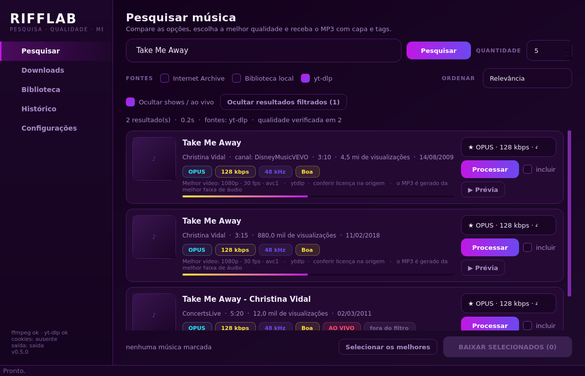
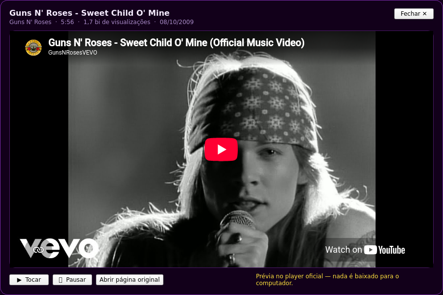
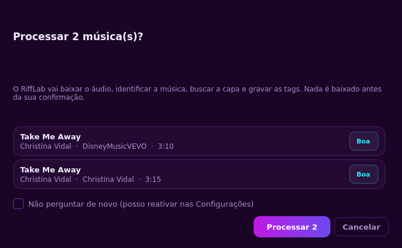
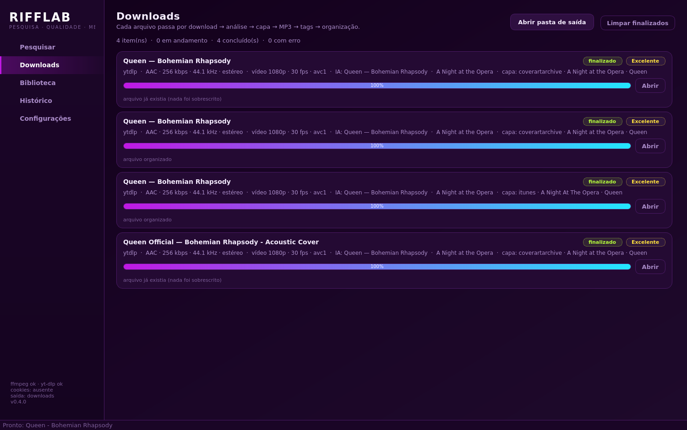
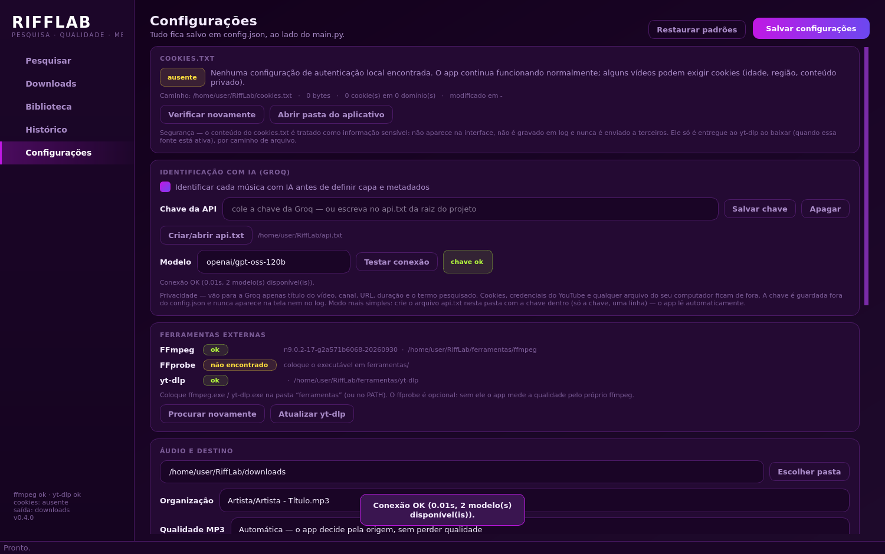

> **Versão 0.11.4:** revisão de metadados mais completa, créditos identificados por origem e proteção do arquivo de cookies durante o uso. Veja [CAPAS-MANUAIS.md](CAPAS-MANUAIS.md).

> **Versão 0.11.3:** a capa escolhida é mantida ao editar os dados; se a identidade mudar, você pode revisar e confirmar a mesma imagem. Veja [CAPAS-MANUAIS.md](CAPAS-MANUAIS.md).

> **Versão 0.11.2:** a nova sugestão confere título e artista juntos em catálogos antes de propor um álbum; dados não encontrados são preservados. Veja [CAPAS-MANUAIS.md](CAPAS-MANUAIS.md).

> **Versão 0.11.1:** a revisão pela IA tenta alternativas quando a Groq não consegue formatar a resposta. Veja [CAPAS-MANUAIS.md](CAPAS-MANUAIS.md).

> **Versão 0.11.0:** em Editar dados, peça uma nova sugestão à IA e confira antes de salvar. A paleta de cores também está em português. Veja [CAPAS-MANUAIS.md](CAPAS-MANUAIS.md).

# RiffLab

> **Versão 0.10.1:** a janela de capa abre enquanto os metadados são identificados em segundo plano; pesquise no Google somente quando desejar e confira os dados antes de confirmar. Veja [CAPAS-MANUAIS.md](CAPAS-MANUAIS.md).

> **Versão 0.9.0:** personalize e salve as cores em Configurações. Veja [PERSONALIZAR-CORES.md](PERSONALIZAR-CORES.md).

> **Versão 0.8.0:** as capas são escolhidas manualmente no Google. Consulte [CAPAS-MANUAIS.md](CAPAS-MANUAIS.md); guias de versões antigas sobre buscas automáticas de capa são históricos.

> **Fluxo atualizado:** consulte [COMECE-AQUI.md](COMECE-AQUI.md) para a instalação e a interface atual de três páginas. O texto e as imagens históricas abaixo descrevem a versão original e podem mencionar opções, telas e processamento simultâneo que não existem mais na interface atual.

**Pesquise · compare a qualidade · escolha · receba o MP3 com capa e metadados.**

Aplicativo desktop local para Windows (Python + PySide6). Não é demo: pesquisa,
compara, baixa, converte, marca capa, grava ID3 e organiza os arquivos de verdade.



> **Novidades da 0.5.0** — pesquisa visual com prévia no player oficial, filtro
> de shows/ao vivo ligado por padrão (com “Mostrar resultados filtrados”),
> seleção **manual** com confirmação antes de processar, capas com pontuação de
> correspondência e **confirmação da capa** antes de gravar no MP3.
> Relatório completo do que mudou: `RELATORIO-v0.5.0.md`.

---

## 1. Instalação (uma vez)

### Opção A — automática (recomendada)

1. Copie a pasta `RiffLab` para onde quiser (ex.: `C:\Users\kimfe\Desktop\RiffLab`).
2. Dê **duplo clique** em **`INICIAR.bat`**.
   Ele cria o `.venv`, instala as dependências e abre o app.

### Opção B — manual

```bat
cd C:\caminho\RiffLab
py -3 -m venv .venv
.venv\Scripts\activate
pip install -r requirements.txt
python main.py
```

Requisitos: **Python 3.10+** (marque “Add Python to PATH” na instalação).

---

## 2. FFmpeg + yt-dlp (as duas ferramentas)

Coloque na pasta **`ferramentas\`**:

| Arquivo | Necessário? | Para quê |
|---|---|---|
| `ffmpeg.exe` | **sim** | conversão para MP3 e análise do áudio |
| `ffprobe.exe` | opcional | leitura mais precisa (sem ele o app usa `ffmpeg -i`) |
| `yt-dlp.exe` | **sim** (é a fonte de pesquisa) | buscar e obter o áudio |

Baixe em <https://www.gyan.dev/ffmpeg/builds/> (build `release essentials`) e
copie da pasta `bin` do zip. O app também encontra as ferramentas no `PATH`.

O **yt-dlp** é o cérebro da pesquisa do RiffLab:

1. <https://github.com/yt-dlp/yt-dlp/releases/latest/download/yt-dlp.exe>
2. salve dentro de `RiffLab\ferramentas\yt-dlp.exe`

Sem esse arquivo a pesquisa volta vazia: o app avisa em **Configurações** e na
própria barra de pesquisa. Mantenha o `yt-dlp.exe` atualizado — as plataformas
mudam com frequência e o próprio `yt-dlp -U` resolve.

Em **Configurações → Ferramentas externas** aparece `ok` + versão quando está tudo certo.

---

## 3. Uso diário

O fluxo tem 10 etapas — as quatro primeiras são suas, o resto é automático:

| # | Etapa | Quem faz |
|---|---|---|
| 1 | **Pesquisa** (música, artista ou gênero) | você |
| 2 | **Análise**: o app consulta cada vídeo (canal, visualizações, data, ao vivo, qualidade) | automático |
| 3 | **Prévia**: ouça no player oficial antes de escolher | você |
| 4 | **Seleção** manual (individual ou várias) | você |
| 5 | **Confirmação** da lista | você |
| 6 | **Processamento** (download → análise real → MP3) | automático |
| 7 | **Identificação** por IA (Groq, se ligada) | automático |
| 8 | **Capa**: busca em cascata com pontuação de correspondência | automático |
| 9 | **Confirmação da capa** (trocar/recusar) | você |
| 10 | **Finalização**: tags + organização + limpeza de temporários | automático |

### 3.1 Pesquisar

Digite música, artista ou gênero (`November Rain`, `Queen`, `Rock`, `Led
Zeppelin`) e pressione **Enter**. Cada cartão mostra **miniatura do vídeo**
(lembre: miniatura **não** é a capa do MP3), título, **canal**, artista, álbum,
duração, **visualizações**, **data de publicação**, os selos de qualidade
(`CODEC · kbps · kHz · nota`) e, quando houver, o aviso **ao vivo**.

**Nada é marcado automaticamente.** A seleção é sua: marque as caixas
`incluir` nos cartões que quiser. Se preferir agilidade, o botão
**Selecionar os melhores** marca os *N* primeiros de maior nota (campo
**Quantidade**), e você pode desmarcar o que não quiser.

### 3.2 Prévia (sem baixar nada)

O botão **▶ Prévia** abre o **player oficial** do vídeo dentro do app
(`youtube-nocookie.com`), com **Tocar/Pausar**. A prévia **nunca baixa o
arquivo**: ela só mostra o player; nenhum arquivo temporário é criado.

Se o dono do vídeo não permitir reprodução incorporada (ou se o QtWebEngine não
estiver instalado), o app diz o motivo e oferece **Abrir página original** — em
vez de fingir que está tocando.



### 3.3 Filtro de shows / ao vivo (ligado por padrão)

O objetivo é te entregar a versão de **estúdio**, não o show gravado com
celular na plateia. O filtro usa os dados do yt-dlp (`live_status`, `is_live`,
`was_live`, `duration`, `availability`) **e** palavras-chave do título
(Live, Ao vivo, Concert, Festival, Unplugged, Bootleg…), que sozinhas valem
apenas como alerta.

A prioridade é: **estúdio** > clipe oficial > oficial com áudio de estúdio >
canal oficial. Resultado ao vivo é **rebaixado e escondido — nunca apagado**:

* o rodapé avisa quantos ficaram de fora;
* o botão **Mostrar resultados filtrados (N)** traz todos de volta;
* no cartão aparece o selo `AO VIVO` (confirmado pelo yt-dlp) ou `possível ao
  vivo` (só indício), com o motivo no tooltip.

Desligue em **Configurações → Pesquisa, shows e prévia** se quiser ver tudo.

### 3.4 Confirmar e processar

Ao clicar em **BAIXAR SELECIONADOS (N)** (ou em **Processar** num cartão), o
app mostra **o que vai fazer** — títulos, canais, qualidade e quais parecem ao
vivo — e espera seu OK. Nada é baixado antes da confirmação. Se não quiser ver
esse aviso sempre, marque *“Não perguntar de novo”* (dá para reativar em
Configurações).



Depois acompanhe em **Downloads**: download → análise → identificação → capa →
MP3 → tags → organização.

### 3.5 Confirmar a capa

Em **Downloads**, abra **Escolher capa** ou **Revisar capas selecionadas**. O Google não abre sozinho: clique em **Pesquisar imagens no Google**, copie uma imagem no navegador e use **Colar imagem copiada**. Confira a prévia e escolha **Usar esta capa** ou **Não usar capa**. Veja [CAPAS-MANUAIS.md](CAPAS-MANUAIS.md).

> **Regra de ouro: é melhor ficar sem capa do que com a capa errada.** Confira a imagem e os direitos de uso.

### 3.6 Resultado

O arquivo final aparece em `downloads\Artista\Artista - Título.mp3`
(ou na pasta escolhida em Configurações), com **capa embutida** e
**título/artista/álbum/ano/faixa/gênero** disponíveis após sua revisão; campos não identificados podem ficar vazios.



---

## 4. Configurações que valem a pena

| Opção | Para quê |
|---|---|
| **Organização** | `Artista/Artista - Título.mp3`, `Artista/Álbum/01 Título.mp3`, por gênero… |
| **Qualidade MP3** | `Automática` (copia MP3 compatível ou converte conforme a origem) · `Alta` (320 kbps) · `Personalizada` (escolhe o bitrate) |
| **Downloads simultâneos** | 1 a 4 — padrão **2** (acima de 4 a plataforma passa a bloquear) |
| **Manter temporários** | só para diagnóstico; normal é apagar `temp/` ao terminar |
| **Baixar capa / Incorporar capa** | desliga a busca de capa ou só a gravação no ID3 |
| **Identificação com IA** | Groq sugere a identificação; confira os dados (opcional) |
| **Capas** | escolha manual, com pesquisa no Google somente ao clicar no botão |
| **Ocultar shows / ao vivo** | filtro ligado por padrão; nada é descartado, só escondido |
| **Pedir confirmação antes de processar** | mostra a lista e espera seu OK (etapa 5) |
| **Pedir confirmação da capa** | você aprova/troca/recusa a capa antes de gravar (etapa 9) |
| **Verificar qualidade em N resultados** | quantos vídeos são analisados automaticamente (0 = só no botão) |
| **Prévia embutida** | precisa do QtWebEngine (vem no `pip install PySide6`); sem ele, abre a página original |
| **Fontes de pesquisa** | yt-dlp (padrão) · Internet Archive (opcional) · Biblioteca local (opcional) |
| **Tamanho mínimo da capa** | rejeita imagem pequena (padrão 300 px) |
| **Sobrescrever** | desligado: duplicata é detectada e ignorada |
| **Biblioteca local** | pasta para indexar e comparar com o que você já tem |
| **Aviso do yt-dlp** | aparece uma vez; “Entendi” dispensa o lembrete legal |



---

## 5. Identificação com IA (Groq) — opcional

A partir da 0.3 o app pode **identificar a música antes de definir capa e tags**,
usando a API da **Groq** (GroqCloud, `api.groq.com` — a plataforma de inferência,
não o "Grok" da xAI). É opcional: desligado, tudo funciona exatamente como antes.

Pontos práticos da Groq: a conta é gratuita em `console.groq.com`, a chave
começa com **`gsk_`** e o plano gratuito tem limite de requisições/tokens por
minuto (o app tenta de novo em falhas de formato e respeita o
`retry-after` quando a Groq pede para esperar). Modelo padrão:
**`openai/gpt-oss-120b`** — é o que aceita *Structured Outputs* com `strict`,
que pode usar saída estruturada; outros modelos aparecem em **Testar
conexão** e podem ser escolhidos no campo **Modelo**.

**Jeito mais fácil: um arquivo `api.txt` na pasta do app**

1. Crie a chave em **`console.groq.com` → API Keys → Create API Key** (a conta e o uso são seus, não do app).
2. Na pasta do RiffLab (a mesma do `main.py`), crie um arquivo chamado
   **`api.txt`** e cole a chave dentro, sozinha, em uma linha:

   ```
   gsk_9f2c1d8ab7e64c0f9d3a5b1e7c4d2a80
   ```

3. Salve. Pronto — o app lê sozinho. Em **Configurações → Identificação com IA**
   aparece `chave carregada` e o caminho do arquivo. Isso não confirma acesso: use **Testar conexão**. Se preferir, clique em
   **Criar/abrir api.txt**: o app cria o arquivo (com as instruções dentro) e
   abre no Bloco de Notas para você colar a chave.

   O arquivo aceita a chave pura, `GROQ_API_KEY=…`, `"…"` ou `Bearer …`, com
   comentários (`#`) e linhas em branco — então pode deixar anotações dentro.
   Também funciona com o nome `api_key.txt`. Há um modelo pronto em
   `api.txt.exemplo`.

> ⚠️ `api.txt` é **texto puro**. Não mande para ninguém, não suba para o Git
> (ele já está no `.gitignore`) e não deixe em pasta compartilhada. Prefere
> guardar cifrado? Use o campo **Chave da API** (o app grava em
> `credenciais\groq.dat`, cifrado com DPAPI no Windows) e apague o `api.txt`.

**Como ligar (pela interface, se preferir)**

1. Crie uma chave em **`console.groq.com` → API Keys**.
2. **Configurações → Identificação com IA (Groq)** → cole a chave →
   **Salvar chave**.
3. Confira o modelo (`openai/gpt-oss-120b` já vem preenchido; pode trocar) e clique em
   **Testar conexão** — deve aparecer “Conexão OK (…s, N modelos)” e o selo
   `chave carregada` (isso apenas confirma a leitura local).
4. Salvar a chave liga a IA e grava essa escolha imediatamente. Você pode desmarcá-la depois; a chave permanece salva.


**O que a IA faz** (e o que ela não faz):

* Recebe título, canal, URL, duração e dados sugeridos pela busca, mas não recebe nem escuta o áudio.
* Tenta sugerir título, artista, participações, artista do álbum, álbum, ano, gênero, número da faixa e outros créditos. A confiança é informada pela própria IA e não prova que os dados estão corretos.
* O app procura uma gravação e um lançamento associado no MusicBrainz; o resultado não garante que a edição ou os demais campos sejam corretos. Campos assinalados como incertos não são usados automaticamente. Dados de IA que não combinam com a música ou versão são descartados.
* Em Downloads, confira os dados após preparar e use **Editar dados** para corrigir. Se faltar algum campo, preencha manualmente; nenhum serviço garante encontrar todos. Se não houver crédito de artista do álbum, o campo pode ficar vazio.
* A duração final é medida a partir do MP3 convertido. A IA não baixa nem converte o áudio. Se estiver desligada ou falhar, o app usa os dados disponíveis nos catálogos e na origem.
* A escolha da capa é manual: pesquise no Google apenas quando desejar e cole a imagem para revisar.

**Privacidade / segurança**

* Ordem em que o app procura a chave: variável de ambiente **`GROQ_API_KEY`** →
  **`api.txt`** na pasta do app → **`credenciais\groq.dat`** (cifrado com DPAPI
  no Windows, permissão 0600 no Linux; sempre fora do `config.json`).
* A chave **nunca** aparece na tela (só `gsk_…cdef`), nunca vai para o log e
  nunca fica no código. O botão **Apagar** remove o arquivo.
* **Cookies do YouTube, sua pasta de downloads, o banco e o histórico não são
  enviados** — o pedido à IA tem só os campos listados acima.

> Sem a IA o app já gravava `TIT2/TPE1/TALB/TCON/TRCK/TPOS/APIC`. Com ela,
> entram também `TCOM` (compositor), `TEXT` (letrista), `TPRO` (produtor),
> `TPUB` (gravadora), `TPE2` (banda/artista do álbum) e `TDRC` com a data
> completa — sempre só quando confirmados.

---

## 6. `cookies.txt` (opcional)

* Em **Configurações → cookies.txt**, clique em **Escolher cookies.txt** e selecione o arquivo no formato Netscape. Você também pode colocá-lo em `RiffLab\cookies.txt`.
* O app verifica se existe, se está legível, se tem conteúdo e se o formato é
  válido — e mostra o resultado em **Configurações**.
* O conteúdo não é mostrado nem registrado pelo app. O yt-dlp usa **cópias temporárias** na pesquisa e no download e pode enviar cookies ao site de origem para autenticação. O arquivo selecionado é preservado; a sessão ainda pode expirar ou ser recusada.
* **Sem o arquivo a pesquisa continua funcionando.** Alguns vídeos podem pedir
  cookies (verificação de idade, região, conteúdo privado); se você escolheu um arquivo e ele sumiu, o app informa em vez de ignorá-lo. Nesses casos o app
  mostra o erro do `yt-dlp` no Histórico, sem quebrar a fila.
* Veja `cookies.txt.exemplo` para o formato.

---

## 7. Perguntas rápidas

**Preciso de internet para tudo?** Para pesquisar, sim: a fonte padrão é o
`yt-dlp`. A Biblioteca local e o processamento de arquivos que você já tem
funcionam offline.

**Ele baixa do YouTube?** Sim — a fonte de pesquisa padrão é o `yt-dlp`, que
consulta plataformas de vídeo e entrega o áudio na melhor qualidade disponível.
Use **somente** com conteúdo que você pode baixar (Creative Commons, domínio
público, seu próprio material). O app mostra o aviso legal uma vez e guarda sua
confirmação em `config.json`. Se preferir acervos públicos, marque apenas
**Internet Archive** em Configurações.

**Qualidade que ele escolhe?** Depois da busca, o app consulta os formatos reais
dos primeiros resultados (6 por vez, em segundo plano) e já deixa o melhor
selecionado: `OPUS 160 kbps · 48 kHz · estéreo`, por exemplo. A mesma consulta
descobre o **melhor vídeo** disponível (`1080p · 30 fps · vp9`), que aparece no
cartão só como informação — o MP3 é gerado da melhor faixa de áudio, porque
baixar o vídeo inteiro gastaria 20–40× mais banda para produzir o mesmo MP3.
Se o vídeo não tiver faixa exclusiva de áudio, o app baixa o arquivo completo e
extrai o áudio dele (isso é automático).

**O que acontece quando eu clico em BAIXAR SELECIONADOS?** Cada música passa por:
analisando → baixando → **identificando com IA** (se ligada) → capa e metadados →
convertendo → gravando tags → organizando. Até **2 músicas ao mesmo tempo** (ajustável), cada uma com sua barra
e seu estado na aba **Downloads**. A interface nunca congela.

**A qualidade ficou em “verificando…” ou “não detectada”?** A busca (lista) é
rápida; a leitura dos formatos exige abrir cada vídeo, e é aí que o YouTube
costuma barrar. O app **não trava**: mostra o motivo no selo, no rodapé e num
aviso, e o botão **Processar continua ativo** (baixa o melhor áudio disponível).
Para saber exatamente o que o yt-dlp respondeu, rode o **`TESTAR_YTDLP.bat`** —
ele grava `teste_ytdlp.txt`. Causas comuns:

| Mensagem | O que fazer |
|---|---|
| `Sign in to confirm you're not a bot` | cookies.txt atualizado, do mesmo navegador/rede; marque “usar cookies” |
| `HTTP Error 429` | muitas consultas seguidas: espere alguns minutos |
| `Video unavailable` / `Private video` | o vídeo não abre sem login/na região; escolha outro resultado |
| `Unsupported URL` / resposta ilegível | use o botão **Atualizar yt-dlp** nas Configurações |
| nada aparece, trava tudo | `yt-dlp.exe` muito antigo: atualize com `-U` (as plataformas mudam toda semana) |

**O resultado que eu queria está escondido.** Ele foi filtrado por parecer
show/ao vivo. Clique em **Mostrar resultados filtrados** — nada é descartado.
Se o filtro estiver atrapalhando, desligue em Configurações.

**A prévia não toca.** O dono do vídeo pode proibir reprodução incorporada, ou o
`QtWebEngine` pode não estar instalado. Use **Abrir página original**. A prévia
nunca baixa o arquivo: quem baixa é o processamento, depois da sua confirmação.

**A capa veio de outra música — o que faço?** Na preparação, pesquise a música correta, copie e cole outra imagem e confira a prévia antes de confirmar. As capas não são pesquisadas automaticamente. Este fluxo não altera arquivos antigos.

**E se o áudio da origem for OPUS/AAC?** O aplicativo escolhe um bitrate de
MP3 estimado a partir da origem. A conversão entre formatos com perda pode causar
perda adicional: bitrate maior não recupera detalhes já perdidos. Se a origem já
é MP3 compatível no modo automático, o áudio é copiado sem recodificação.

**O MP3 perde qualidade?** Se a origem já é MP3, o áudio é **copiado**
(`-c:a copy`), sem reencode. Se é FLAC/WAV, vai para MP3 320 kbps. O histórico
mostra `copiar` ou `recodificar` em cada arquivo.

**Onde ficam meus dados?** Só na pasta do app: `config.json`, `rifflab.db`,
`rifflab.log` e, se você usar a IA, a chave em `api.txt` ou `credenciais\groq.dat`. O que sai do computador: as consultas de pesquisa (yt-dlp), a busca de
capa (iTunes/MusicBrainz) e — **somente com a IA ligada** — título do vídeo,
canal, URL e duração para a Groq. Cookies e arquivos locais nunca são enviados.

**Deu erro no `INICIAR.bat`** → rode o **`DIAGNOSTICO.bat`** (ele mostra Python,
`.venv`, pacotes, ferramentas e as últimas linhas do `rifflab.log`). Ou faça na mão:

```bat
cd C:\caminho\RiffLab
py -3 -m venv .venv
.venv\Scripts\python.exe -m pip install -r requirements.txt
.venv\Scripts\python.exe main.py --debug
```

**“X foi inesperado neste momento”** era um defeito do `.bat` antigo (parênteses
e quebras de linha Linux). Já corrigido nesta versão: o `INICIAR.bat` usa só
rótulos/`goto`, com terminações CRLF e texto ASCII.
